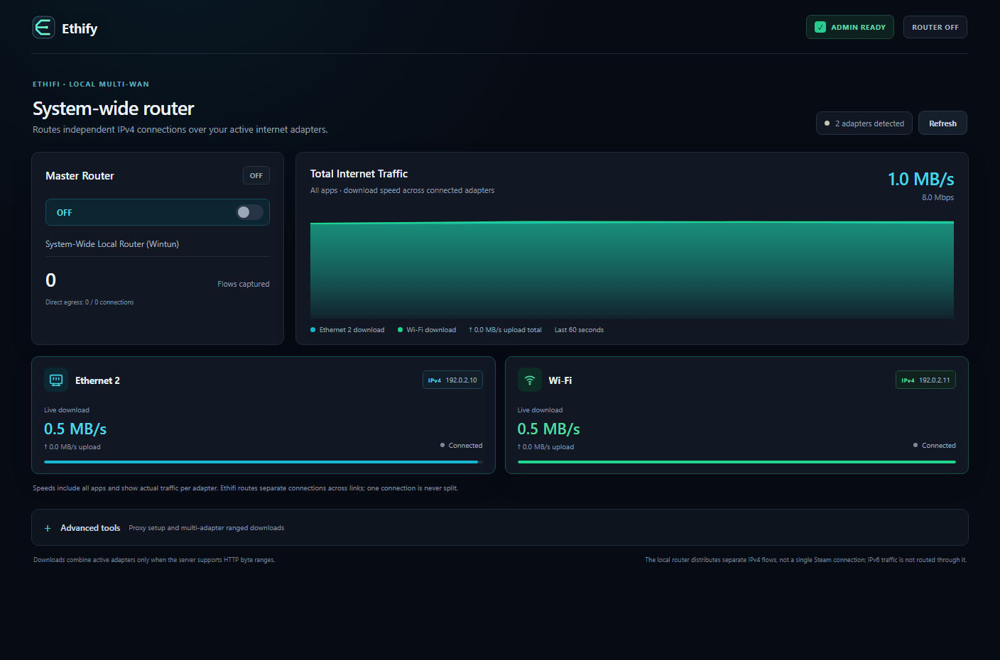

# Ethify

Ethify combines Wi-Fi and Ethernet for one direct HTTP(S) download by fetching byte ranges concurrently over sockets bound to each selected network adapter. Downloads are saved in the current user's `Downloads` folder.

**Download:** [Latest release and installers](https://github.com/aa13244296-ux/Ethify/releases/latest) · [Roadmap](ROADMAP.md)

## Run Ethify on Windows

1. Download and run the Windows x64 setup installer from the [latest release](https://github.com/aa13244296-ux/Ethify/releases/latest).
2. Launch Ethify from the Start menu or desktop shortcut and approve the Windows UAC prompt; administrator rights are needed for the system-wide Wintun router.
3. The Ethify desktop app opens in its own window. Closing the window hides Ethify to the notification area beside the clock; click its tray icon to reopen it, or right-click and choose **Exit** to shut it down. Leave **System-wide local router** off until you intentionally want to route IPv4 traffic through Ethify.



To build the packaged app from source:

```powershell
.\scripts\build-windows.ps1
.\dist\Ethify-1.1.1-windows-x64\Ethify.exe
```

For UI development, start Ethify and then run `npm ci` and `npm run dev` from `ui_source`; Vite serves at `http://localhost:5173`.

The Windows app uses an embedded WebView2 window with Ethify's own name and icon rather than opening an Edge app window. Windows may show an "Unknown publisher" warning because this build is not code-signed; the publisher identity can only be verified with a trusted signing certificate.

## Run Ethify on Linux

The Linux installer is a Debian/Ubuntu `.deb` package available from the [latest release](https://github.com/aa13244296-ux/Ethify/releases/latest). Install it with:

```bash
sudo apt install ./ethify_*_amd64.deb
```

Then launch **Ethify** from your desktop's application menu. The package installs the dashboard, direct HTTP(S) range downloads, browser handoff, torrents, and relay client. Socket binding uses Linux `SO_BINDTODEVICE`, so selected physical Ethernet/Wi-Fi adapters are pinned for each outgoing TCP or UDP connection instead of silently falling back to the default route. The system-wide Wintun router remains Windows-only.

```bash
make client-linux
./bin/ethify-client-linux-amd64
```

Linux direct-download aggregation requires at least two active physical IPv4 adapters and a server that supports HTTP byte ranges. The system-wide Wintun router remains Windows-only.

## Local multi-adapter proxy

Enable **Local Multi-Adapter Proxy** in the dashboard to listen on SOCKS5 `127.0.0.1:1080` and HTTP `127.0.0.1:8080`. Select at least two active adapters in the Networks list; while the proxy is running, those selections update its pool. If an adapter disconnects, Ethify removes the stale path and keeps the proxy on any remaining selected adapter, but it no longer combines bandwidth. Configure an application to use one of the displayed proxy addresses. New TCP connections are distributed across the selected adapters, with failed paths temporarily deprioritized.

On Windows, the **Windows user proxy** toggle starts the local HTTP proxy if needed, saves the current per-user Internet Settings values, and points proxy-aware applications at `127.0.0.1:8080`. Ethify restores the saved settings on a graceful exit or next startup after a crash, and leaves later user changes untouched.

This is a local connection-balancing proxy, not a system-wide tunnel: applications must support SOCKS5 or HTTP proxy settings, UDP is not proxied, and an established connection cannot move to another adapter after it resets. It distributes separate connections; it does not combine the bandwidth of one TCP connection.

The dashboard's **Launch App via Proxy** control starts a selected executable with `HTTP_PROXY=http://127.0.0.1:8080`, `HTTPS_PROXY=http://127.0.0.1:8080`, and `ALL_PROXY=socks5h://127.0.0.1:1080` in its child environment. The local proxy must be running first. The Steam preset locates the installed Steam executable from its Windows registry entry or standard Program Files locations. Environment variables are advisory: applications must honor them, and Steam may ignore them. This does not intercept traffic or guarantee that an app uses the proxy.

Ethify deliberately does not install a packet-divert driver or hook game sockets for transparent per-app interception. Games with anti-cheat software can treat socket interception as suspicious; use the Windows user proxy only for applications that honor the operating-system proxy setting.

## System-wide adapter speed meter

On Windows, **Internet speed by adapter** reads the operating system's Ethernet and Wi-Fi byte counters once per second. It reports download and upload rates per adapter for all applications, including Steam even when Steam does not use Ethify's proxy. These measurements show which active adapter is carrying traffic; they do not mean Ethify is aggregating Steam's connections or combining a single Steam transfer.

The app-usage panel under the download speed chart reports current IPv4 TCP data rates by process and adapter. Windows only exposes these per-connection counters for TCP; UDP traffic appears in the adapter totals above but cannot be attributed to an application in this panel.

## Combine a download

1. Keep both Wi-Fi and Ethernet connected.
2. Leave both adapters enabled in Ethify's Networks list.
3. Paste a direct file URL and choose **Combine & download**.

Ethify probes each selected adapter before starting. The server must support HTTP byte ranges and be reachable over both connections; otherwise Ethify reports the problem instead of silently downloading over just one link. The dashboard reports actual bytes and rates per adapter.
If an adapter fails during a ranged download, Ethify retries the affected chunk over another selected adapter instead of aborting the whole download.

Downloads can be paused and resumed from the **Downloads** tab, including after Ethify closes or Windows restarts. Partial files remain in the output folder; private checkpoints are stored in Ethify's per-user resume folder (or a hidden `.ethifi-resume` folder for a custom output folder). Only completed byte ranges are kept; an interrupted range is downloaded again. Resume requires the server to still provide the same file and support byte ranges.

## Catch browser downloads

The Chromium extension in `browser-extension` works with Brave and other Chromium browsers. Start Ethify, select at least two active adapters, then open `brave://extensions`, enable **Developer mode**, and choose **Load unpacked** with the repository's `browser-extension` folder. **Catch supported downloads** is enabled by default; use the extension popup to turn it off. Ethify must be running at `http://127.0.0.1:18888`.

The extension only hands off direct HTTP(S) downloads when Ethify can reach the file over at least two active IPv4 adapters and the server supports byte ranges. It waits until Ethify has received data before cancelling the browser's original transfer; if Ethify cannot start, the browser download is left running. Direct `.torrent` file downloads are handed to Ethify's torrent queue; if Ethify is unavailable, the browser download continues. URLs that require browser cookies or custom request headers may not be usable by Ethify. Magnet links and magnet-page navigation are not intercepted.

The **Torrents** tab accepts magnet links and direct HTTP(S) `.torrent` URLs. Ethify binds outgoing TCP peer connections across the selected adapters to distribute separate peer transfers; an individual peer connection is not split. DHT and UDP tracker discovery use one selected adapter, IPv6 and incoming peer connections are disabled, and Ethify does not upload or seed. Torrent data is saved in the current user's `Downloads` folder. Active torrents are paused when Ethify closes; saved metainfo and downloaded pieces are reused when resumed. Discarding resume data does not delete downloaded torrent files.

## System-wide local router

On Windows, run Ethify as Administrator and enable **System-wide local router** to route IPv4 traffic through a local Wintun adapter and a gVisor TCP/IP stack. Ethify opens separate outbound TCP and UDP flows directly over the active physical adapters, selecting the adapter with the lowest recent egress throughput and then the fewest active flows. The dashboard reports router egress flows and measured rates per adapter. A failed adapter is deprioritized for four seconds before it is probed again. The router supports up to 512 concurrent live egress connections and closes TCP flows after 30 seconds without successful I/O. Optional per-adapter rate caps limit combined upload and download traffic routed through Wintun on that adapter; direct traffic outside the router is unaffected, and zero means unlimited. The router does not use a remote relay. At least two active IPv4 adapters are required to start. The feature must remain off unless deliberately enabled, and it cannot run at the same time as the relay tunnel.

This is per-connection load balancing, not bonding one connection. If Steam opens several independent TCP flows while the router is active, Ethify can place those flows on different adapters; a single Steam flow cannot be split and Steam may instead be limited by its CDN, account, or network policy. ForceBindIP-style process binding selects one interface for a process and does not itself merge link speeds, so Ethify keeps multi-adapter routing at the flow level rather than pinning Steam to one link. If an adapter disconnects, established flows using it can fail; new flows can use the remaining active adapter. IPv6 traffic is not included in this IPv4 router. The split-default routes are temporary (not persistent); Ethify removes stale routes from a prior crashed session before starting, and removes its routes when the switch is turned off or Ethify exits. Flow workers and outbound dials are bounded to limit resource use during connection churn.

## Ownership

Ethify is owned by A2L and made by A2L. Third-party license notices are preserved in [LICENSE](LICENSE).
